# preview-env-platform

[](https://github.com/tenalisriharsha/preview-env-platform/actions/workflows/ci.yaml)

A mini platform-engineering tool: **every pull request gets its own temporary
Kubernetes environment**, a namespace running the PR build of the app, with the
preview URL commented back on the PR. When the PR is merged or closed, the
environment is torn down automatically. If teardown misses one, an hourly
in-cluster CronJob deletes preview namespaces older than 24 hours.

GitHub Actions driven · Kustomize based · stdlib-only Python CLI · unit tested.

## Preview

`previewctl` rendering a real overlay for PR #42 the way the preview workflow
does (no live cluster needed, it's pure local templating):

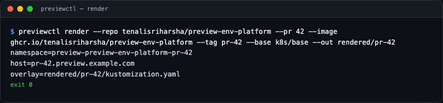

What lands on the PR: the real markdown `build_comment()` produces, rendered
with cmark-gfm (GitHub's Markdown library):

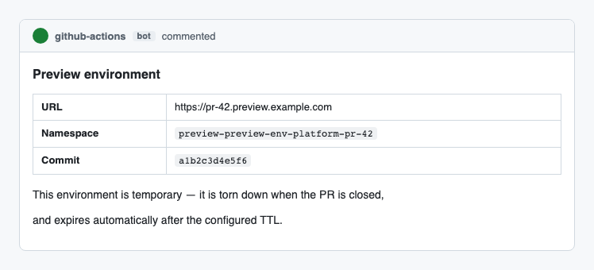

The cleanup safety net on a live cluster: PR 41's namespace is past the
TTL, PR 42's is not, and only PR 41's is deleted:

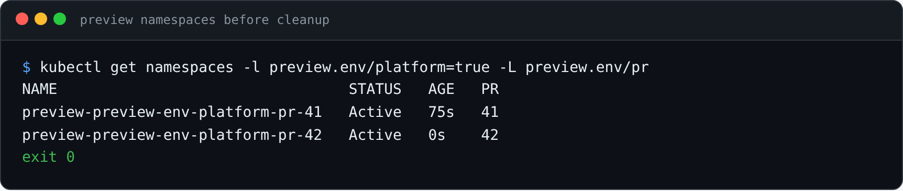

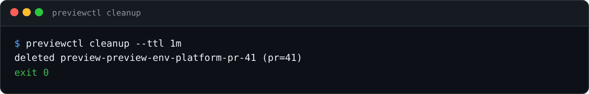

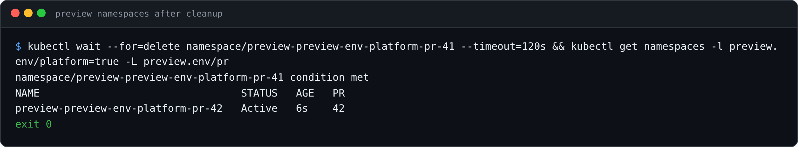

<details>
<summary>More views</summary>

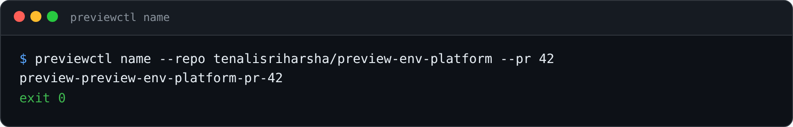

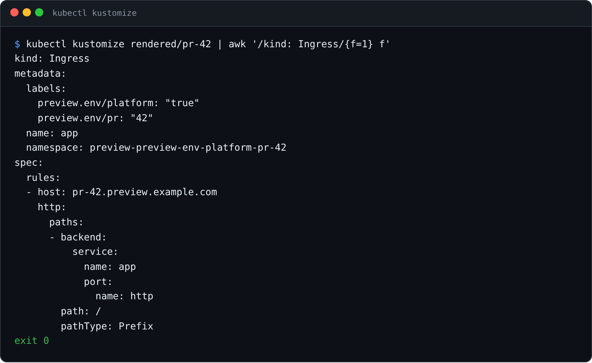

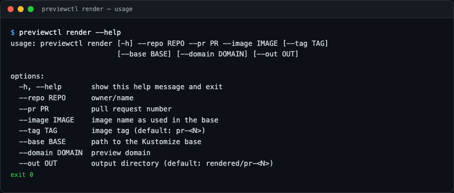

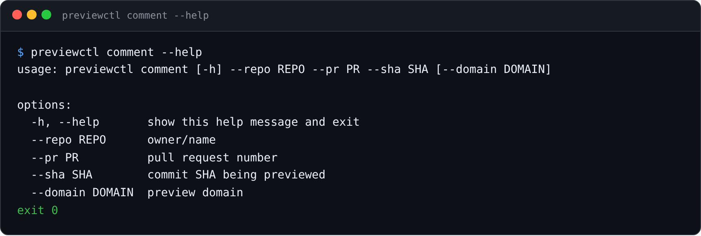

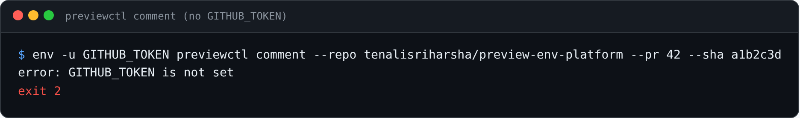

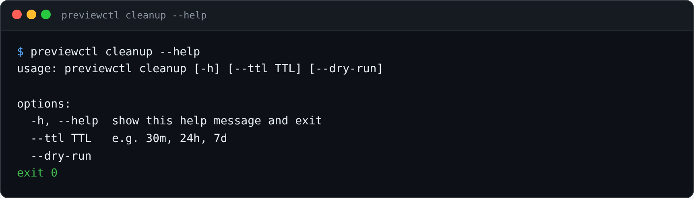

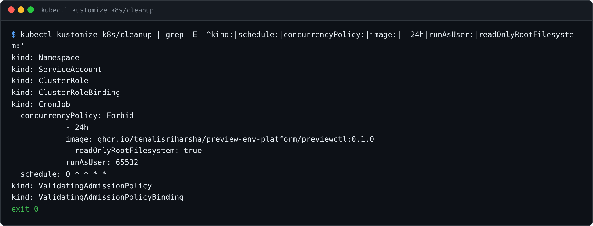

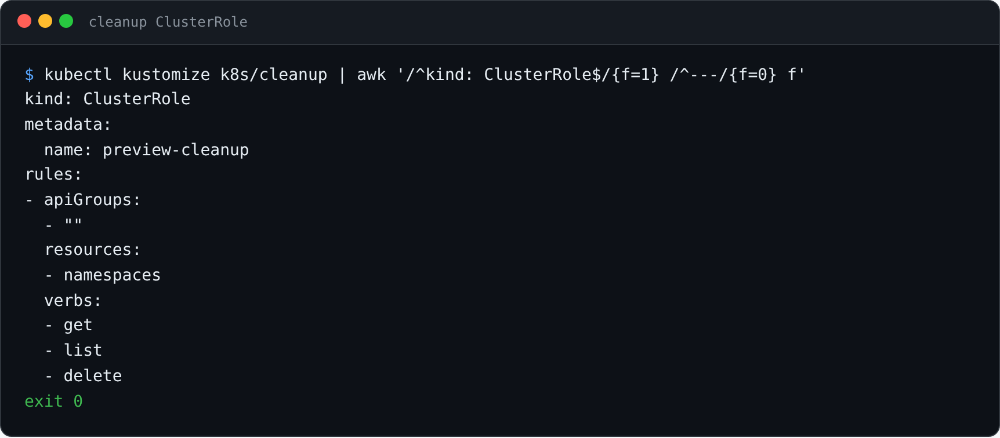

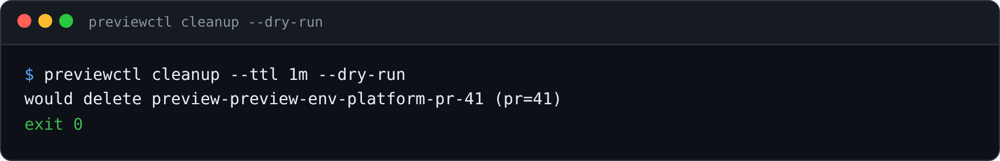

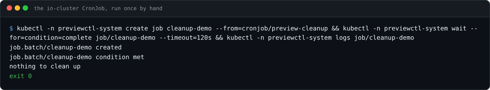

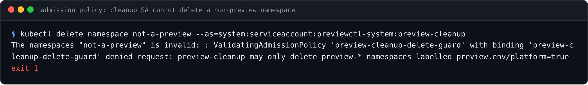

Every image is regenerated from real command output by
[`docs/screenshots/generate.py`](docs/screenshots/generate.py)
(`pip install -e .[screenshots]`, needs `kubectl` on PATH). Images 11-16
need `--cluster` and a throwaway cluster with `k8s/cleanup` installed; the
ones here came from a local k3s cluster.

</details>

## How it works

```
PR opened/updated ──► GitHub Actions ──► build image (PR tag)
                                     ──► render Kustomize overlay (previewctl)
                                     ──► kubectl apply → namespace preview-*-pr-N
                                     ──► comment preview URL on the PR

PR closed/merged  ──► GitHub Actions ──► kubectl delete namespace

Hourly (safety)   ──► in-cluster CronJob ──► previewctl cleanup --ttl 24h
                                             (deletes expired preview namespaces)
```

The deep-dive (naming, the TTL design, both RBAC identities, the admission
policy, known limitations) is in [docs/architecture.md](docs/architecture.md).

## Quickstart

Locally, no cluster needed:

```bash
python3 -m venv .venv && source .venv/bin/activate
pip install -e .[dev]
previewctl name --repo octocat/demo --pr 7          # preview-demo-pr-7
previewctl render --repo octocat/demo --pr 7 --image preview-app \
  --base ./k8s/base --out rendered/pr-7
kubectl kustomize rendered/pr-7                      # the manifests a PR gets
pytest
```

Against a cluster:

- [docs/local-e2e.md](docs/local-e2e.md): deploy, curl, tear down and run
  the cleanup on a local cluster.
- [docs/setup.md](docs/setup.md): connect a real cluster and repository
  (deployer kubeconfig, the `KUBECONFIG` secret, `PREVIEW_DOMAIN`,
  `GITHUB_TOKEN`, installing the CronJob).

## Project Status

All three phases are built. See [PROGRESS.md](PROGRESS.md) for the build
log and [CHANGELOG.md](CHANGELOG.md) for v0.1.0 (prepared, not yet tagged).

What has been verified, and how:

- **Unit and manifest tests** (`pytest`) run in CI on every push and PR,
  and CI builds the cleanup image and smoke-tests it.
- **On a live cluster** (single-node k3s v1.34, run by hand): a preview
  deployed with `kubectl apply -k`, its pod became Ready and served
  `curl` through its Service; a deploy and teardown using only the
  `preview-deployer` identity; `previewctl cleanup` deleted only the
  expired of two preview namespaces; the CronJob ran in-cluster, on
  schedule and on demand, under Pod Security `restricted`, and deleted an
  expired namespace; the admission policy refused non-preview deletes.

Not verified yet:

- the **GitHub Actions preview and teardown workflows** end to end against
  a real cluster (they have only been linted and structurally tested);
- **Ingress routing** to the `pr-<N>.<domain>` host (no ingress controller
  was installed);
- **`kind`** itself (`docs/local-e2e.md` was run on k3s instead);
- the **image publish workflow** (`release-image.yaml`), which only runs
  when a `v*` tag is pushed.

## Layout

```
app/                  tiny stdlib HTTP server + Dockerfile, the preview workload
src/previewctl/       stdlib-only CLI: naming, render, comment, cleanup, kubectl/GitHub I/O
tests/                pytest suite for the CLI and the manifests
k8s/base/             Kustomize base (Deployment, Service, Ingress) for the sample app
k8s/rbac.yaml         least-privilege deployer ServiceAccount/ClusterRole
k8s/cleanup/          hourly cleanup CronJob, its RBAC and admission policy
Dockerfile.previewctl image for the CronJob: previewctl + kubectl
.github/              CI, preview/teardown workflows, image publish on tags
docs/                 architecture, setup guide, local end-to-end guide, screenshots
```

## The workflows

- **`.github/workflows/preview.yaml`** (PR opened/updated): builds and pushes
  the app image tagged `pr-<N>`, renders the per-PR overlay with
  `previewctl render`, applies it with `kubectl apply -k`, waits for the
  rollout, then upserts the preview-URL comment with `previewctl comment`.
- **`.github/workflows/teardown.yaml`** (PR closed): `previewctl teardown`
  deletes the namespace. It refuses anything without the `preview-` prefix.
- **`.github/workflows/release-image.yaml`** (`v*` tag): builds
  `Dockerfile.previewctl` for amd64/arm64 and pushes
  `ghcr.io/<owner>/<repo>/previewctl:<version>`, the image `k8s/cleanup`
  uses.

The preview and teardown workflows expect a `KUBECONFIG` secret; the
preview domain comes from the `PREVIEW_DOMAIN` repository variable. See
[docs/setup.md](docs/setup.md).

## The cleanup CronJob

`kubectl apply -k k8s/cleanup` installs, in a `previewctl-system` namespace:

- a CronJob running `previewctl cleanup --ttl 24h` at minute 0 of every
  hour, `concurrencyPolicy: Forbid`, bounded history, CPU/memory limits,
  non-root with a read-only root filesystem;
- a ServiceAccount whose ClusterRole is `get`/`list`/`delete` on
  namespaces and nothing else;
- a `ValidatingAdmissionPolicy` (Kubernetes 1.30+) that rejects any
  namespace delete by that ServiceAccount unless the namespace is
  `preview-*` and labelled `preview.env/platform=true`.

The image is built from `Dockerfile.previewctl`:

```bash
docker build -f Dockerfile.previewctl -t previewctl:0.1.0 .
```

The kustomization points at
`ghcr.io/tenalisriharsha/preview-env-platform/previewctl:0.1.0`, which is
published when `v0.1.0` is tagged; to use another registry, override the
image in an overlay ([docs/setup.md](docs/setup.md#5-install-the-cleanup-cronjob)).

The TTL counts from when a preview namespace was first created, so a PR
open longer than 24 hours loses its environment until its next push. See
[known limitations](docs/architecture.md#known-limitations).

## License

MIT, see [LICENSE](LICENSE).
